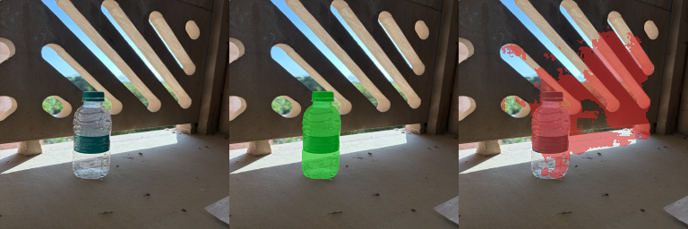
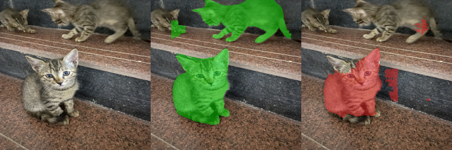

# CSL7360 Assignment 2 — Cost-Efficient Segmentation Report

**Track:** B (Fully Convolutional Network)  
**Workspace:** `/Users/richie/CV_2`  
**CPU model (timed inference):** Apple M2, MacBook Air, 8 GB unified memory  
**Inference setup:** single CPU thread (`OMP/MKL/OPENBLAS/VECLIB=1`, `cv2.setNumThreads(1)`, `torch.set_num_threads(1)`), timed with `time.process_time()`

---

## 1. Method

We build a small **U-Net-style FCN from scratch** (`ces/model.py`):

- **Encoder:** three stages of Conv–BN–ReLU + depthwise-separable convolution, each followed by max-pooling.
- **Bottleneck** at 1/8 spatial resolution.
- **Decoder:** transposed convolutions (×2) with **U-Net skip concatenations**, then a 1×1 head with 2 logits (background / object).
- **Base width** = 16 channels; the network runs internally at **128×128**.

**Timed pipeline** (starts with a 256×256 RGB image already in memory):

1. Convert to a float tensor in \([0,1]\).
2. Bilinear downsample to 128×128.
3. Forward through TinyUNet.
4. Bilinear upsample logits to 256×256 and take `argmax`.

Training used DUTS-TR only. Images are resized with `cv2.INTER_AREA` and masks with `cv2.INTER_NEAREST`; a pixel is object if the mask value is ≥ 128. Loss = weighted pixel cross-entropy + Soft Dice. Optimiser Adam with cosine LR schedule. Training ran on Apple MPS; the timed path is CPU-only. Learned weights are saved as **float16** in `checkpoints/model.pt` (no extra compression).

### Train / validation split

| Split | Size | Notes |
| --- | ---: | --- |
| DUTS-TR train | **9498** | 90% of DUTS-TR, seed 42 |
| DUTS-TR validation | **1055** | held out; used for all design choices |
| DUTS-TE | **5019** | evaluation / CES only — never used for training or early stopping |
| Captured photos | **7** | real iPhone photos; test only |

---

## 2. How we kept it fast (and small)

| Design choice | Why it helps on M2 Air |
| --- | --- |
| Internal 128×128 | ~4× fewer pixels than full 256 |
| Depthwise-separable blocks | Far fewer MACs than dense 3×3 stacks |
| Base channels = 16 | Tiny activation maps; fits 8 GB comfortably |
| No morphology / CRF / GrabCut at test time | Mask is a single `argmax` |
| float16 checkpoint | \(S_\mathrm{disk}\) ≈ 0.55 MiB |

On this machine the DUTS-TE average CPU time is **~16 ms**, well under the 50 ms hard limit.

---

## 3. Results table

\[
Q = 0.70\,\mathrm{mIoU} + 0.30\,\mathrm{BF1}
\]

\[
\mathrm{CES} =
\begin{cases}
Q\bigl(1 - 0.20\,T_\mathrm{CPU}/50\,\mathrm{ms} - 0.10\,\min(1, S_\mathrm{disk}/4\,\mathrm{MiB})\bigr)
& \text{if } T_\mathrm{CPU}\le 50\,\mathrm{ms}\\
0 & \text{otherwise}
\end{cases}
\]

| Set | mIoU | Boundary F1 | Q | \(T_\mathrm{CPU}\) | \(S_\mathrm{disk}\) | CES |
| --- | ---: | ---: | ---: | ---: | ---: | ---: |
| Validation (1055) | 0.828 | 0.549 | **0.744** | — | — | — |
| DUTS-TE (5019) | 0.677 | 0.371 | **0.585** | **15.90 ms** | **576,923 B** | **0.540** |
| Captured (7) | 0.700 | 0.383 | **0.605** | — | — | — |

`predict.py` example output (20 timed runs after warmup):

```
T CPU ms: 14.47
S disk bytes: 576923
```

Raw numbers are also stored in `results/metrics.json`.

---

## 4. Captured photos — true vs predicted overlays

Seven real phone photos (indoor/outdoor, desk clutter, balcony daylight, multiple cats, thin plant leaves, crocs on a desk).  
For **every** captured photo, true (green) and predicted (red) semi-transparent overlays are shown side by side in:

**[`figures/captured_true_vs_pred.png`](figures/captured_true_vs_pred.png)**

Per-image panels also live in `figures/captured_overlays/`.

Folder layout (assignment requirement):

```
captured/
  original/       # full-resolution iPhone photos (.jpg)
  images_256/     # 256×256 PNG (INTER_AREA)
  masks_256/      # binary PNG masks, object=255, background=0
```

Conditions covered: indoor + outdoor, daylight + indoor tube/LED light, near + far objects, cluttered office backgrounds, and partial multi-object / occlusion-like scenes (cats on stairs).

---

## 5. Failure cases (at least two)

### Failure 1 — Small transparent bottle outdoors (`bottle_outdoor`)



- **True (green):** tight mask on the clear bottle.  
- **Predicted (red):** only part of the bottle is recovered; high-contrast balcony cut-outs / sky leaks into the prediction.  
- **Likely causes:** **small object** in the frame, **transparency / reflections**, and a **cluttered geometric background** under strong daylight. A 128×128 TinyUNet has limited resolution for thin plastic edges.

### Failure 2 — Multiple cats on textured stairs (`cat`)



- **True (green):** several kittens marked as object.  
- **Predicted (red):** mainly the large foreground kitten; smaller / blurred background cats are missed or weakly recovered; some stair texture is falsely activated.  
- **Likely causes:** **multiple objects**, **motion blur**, **clutter / texture similarity** between tabby fur and speckled stone, and limited capacity of a tiny FCN to assign every instance at once.

---

## 6. Reproducing

```bash
cd /Users/richie/CV_2
source .venv/bin/activate
python predict.py --image captured/images_256/bottle.png --out mask.png
python eval.py --out results/metrics.json          # full TE timing + all sets
python make_overlays.py                            # regenerate captured figure
```

Training (optional; checkpoint already provided):

```bash
python train.py --epochs 10 --batch-size 24 --num-workers 0
```
